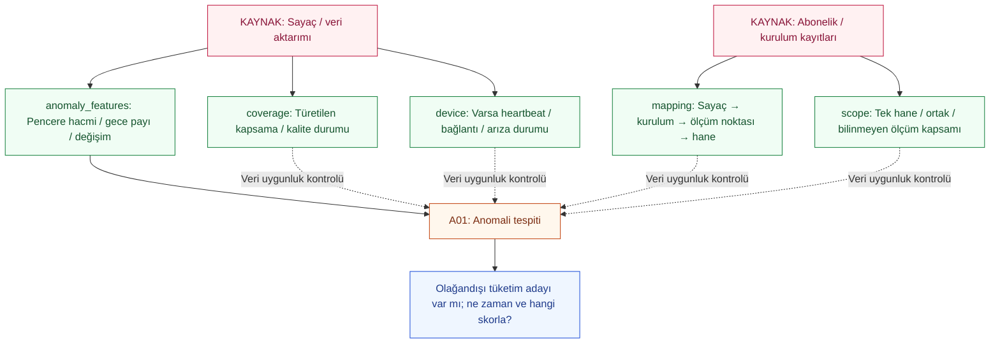
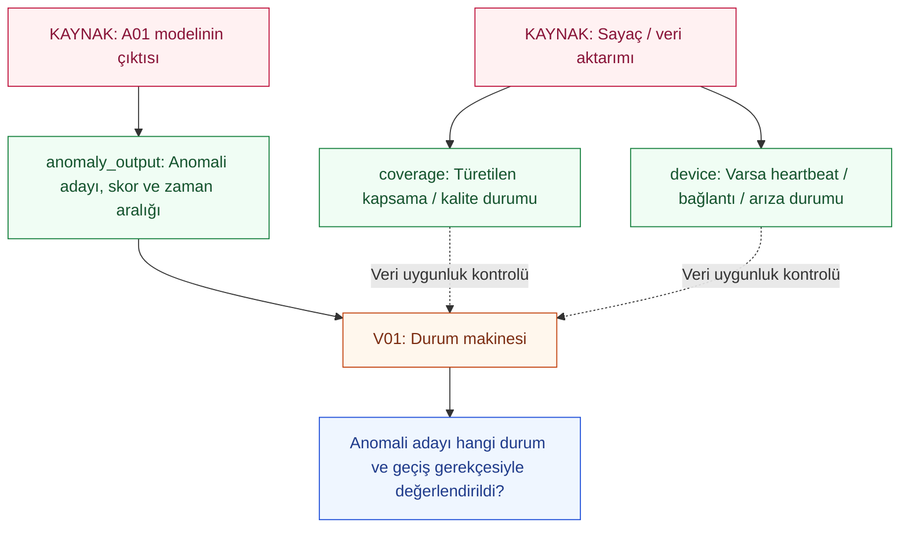
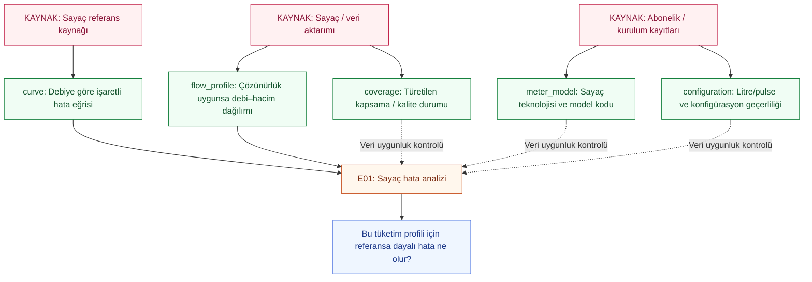
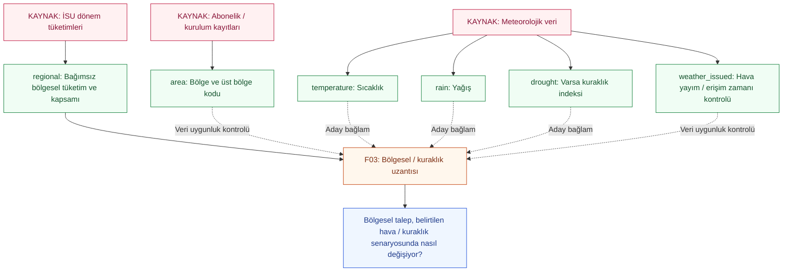

# Projenin kaynak–alan–model–sonuç haritası

Üretilmiş görünüm: `model-flow-map.v0.1.json` dosyasını düzenleyip
`python scripts/build_model_flow_map.py` çalıştırın. Eğitim yapılmış değildir.

Kırmızı: kaynak · Yeşil: veri · Turuncu: model/analiz · Mavi: sonuç.
Düz ok: temel özellik · Kesikli ok: aday bağlam veya uygunluk kontrolü.
Yorum/değerlendirme alanları modele girdi oku çizilmeden ayrıca listelenir.

## Kaynaklar ve model planındaki alanlar

### Saha anketi

Soru formu incelendi; doldurulmuş yanıtlar henüz doğrulanmadı.

- `H01` — Hanede kalan kişi sayısı. `#/$defs/SurveyAnswers/properties/H01`
- `H03` — Gündüz evde bulunan kişi sayısı. `#/$defs/SurveyAnswers/properties/H03`
- `H04` — Yıl boyu / dönemsel kullanım. `#/$defs/SurveyAnswers/properties/H04`
- `G01` — Gelir bandı — kesin maaş değil. `#/$defs/SurveyAnswers/properties/G01`
- `K01` — Konut türü. `#/$defs/SurveyAnswers/properties/K01`
- `K03` — Konut alanı bandı. `#/$defs/SurveyAnswers/properties/K03`
- `K05` — Özel bahçe / sulanan alan var mı?. `#/$defs/SurveyAnswers/properties/K05`
- `K06` — Bahçe suyu izlenen sayaçtan mı?. `#/$defs/SurveyAnswers/properties/K06`
- `K08` — Sayaç yalnız bu haneyi mi ölçüyor?. `#/$defs/SurveyAnswers/properties/K08`
- `K09` — Alternatif su kaynağı. `#/$defs/SurveyAnswers/properties/K09`
- `K10` — Su deposu var mı?. `#/$defs/SurveyAnswers/properties/K10`
- `E01` — Çamaşır / bulaşık / arıtma cihazı varlığı. `#/$defs/SurveyAnswers/properties/E01`
- `D07` — Son 30 günde bildirilen kaçak. `#/$defs/SurveyAnswers/properties/D07`
- `O01` — Misafir / boş kalma / tadilat gibi olay. `#/$defs/SurveyAnswers/properties/O01`
- `consent` — Katılım onay durumu. `#/$defs/SurveyResponse/properties/participation_consent`
- `installation_consent` — Kurulum onay durumu. `#/$defs/SurveyResponse/properties/installation_consent`
- `events` — Tarihli olay ve kanıt türü. `#/$defs/HouseholdEvent`

### İSU hane / kişi tabloları

Tablo yapısı incelendi; temiz araştırma eşlemesi hazırlanacak.

- `home_category` — Aile / bekar / öğrenci hane kategorisi. `#/$defs/InstitutionalHouseholdProfile/properties/home_category`
- `dwelling_type` — Kurumsal konut sınıfı. `#/$defs/InstitutionalHouseholdProfile/properties/dwelling_type`
- `household_size` — Kurumsal hane nüfusu — 8+ korunur. `#/$defs/InstitutionalHouseholdProfile/properties/household_size`
- `pets` — Evcil hayvan kategorisi. `#/$defs/InstitutionalHouseholdProfile/properties/pets_category`
- `legacy_income` — Eski gelir sınıfı — G01 ile aynı değil. `#/$defs/InstitutionalHouseholdProfile/properties/income_category`
- `age` — Kişi yaş bandı. `#/$defs/MemberProfile/properties/age_band`
- `gender` — Kaynak cinsiyet kategorisi. `#/$defs/MemberProfile/properties/sex_gender_category`
- `marital` — Medeni durum kategorisi. `#/$defs/MemberProfile/properties/marital_status`
- `education` — Eğitim kategorisi. `#/$defs/MemberProfile/properties/education_category`
- `activity` — Faaliyet / çalışma kategorisi. `#/$defs/MemberProfile/properties/activity_category`

### Sayaç / veri aktarımı

Gerçek sağlayıcı örneği ve zaman çözünürlüğü bekleniyor.

- `raw` — Pulse / endeks / dönem okuması ve zamanı. `#/$defs/MeterMeasurement`
- `device` — Varsa heartbeat / bağlantı / arıza durumu. `#/$defs/DeviceStatus`
- `liters` — Türetilen saatlik / günlük litre. `Türetilir: raw, configuration, mapping, scope`
- `coverage` — Türetilen kapsama / kalite durumu. `Türetilir: raw, device`
- `shape` — Saatlere göre tüketim payları. `Türetilir: liters, coverage`
- `daily_history` — Günlük gecikmeler ve hareketli özetler. `Türetilir: liters, coverage`
- `intraday_history` — Tahmin saatine kadar gün içi tüketim. `Türetilir: liters, coverage, calendar`
- `hourly_history` — Saatlik gecikmeler ve hareketli özetler. `Türetilir: liters, coverage`
- `calendar` — Saat / haftanın günü / ay. `Türetilir: raw`
- `anomaly_features` — Pencere hacmi / gece payı / değişim. `Türetilir: liters, coverage`
- `flow_profile` — Çözünürlük uygunsa debi–hacim dağılımı. `Türetilir: raw, configuration, coverage`

### Abonelik / kurulum kayıtları

Araştırma kodları ve tarihli kapsam eşlemesi doğrulanacak.

- `configuration` — Litre/pulse ve konfigürasyon geçerliliği. `#/$defs/Configuration`
- `mapping` — Sayaç → kurulum → ölçüm noktası → hane. `#/$defs/Installation`
- `scope` — Tek hane / ortak / bilinmeyen ölçüm kapsamı. `#/$defs/HouseholdLink`
- `area` — Bölge ve üst bölge kodu. `#/$defs/Area`
- `meter_model` — Sayaç teknolojisi ve model kodu. `#/$defs/Meter`

### İSU dönem tüketimleri

Aylık ve bölgesel kapsam / erişim doğrulanacak.

- `monthly` — Kodlanmış aboneliğin dönem tüketimi. `#/$defs/MonthlyConsumption`
- `regional` — Bağımsız bölgesel tüketim ve kapsamı. `#/$defs/AreaConsumption`

### Meteorolojik veri

Sağlayıcı, bölge ve yayımlanma zamanı eşlemesi belirlenecek.

- `temperature` — Sıcaklık. `#/$defs/Weather/properties/variables`
- `rain` — Yağış. `#/$defs/Weather/properties/variables`
- `drought` — Varsa kuraklık indeksi. `#/$defs/Weather/properties/variables`
- `weather_issued` — Hava yayım / erişim zamanı kontrolü. `#/$defs/Weather/properties/issued_at`

### Sayaç referans kaynağı

Geçerli eğri / kalibrasyon ve model uygunluğu doğrulanacak.

- `curve` — Debiye göre işaretli hata eğrisi. `#/$defs/MeterErrorCurve`

### A01 modelinin çıktısı

Henüz üretilmedi; V01 için modelden gelen ara sonuç.

- `anomaly_output` — Anomali adayı, skor ve zaman aralığı. `#/$defs/Anomaly`

## P01 — Tüketim profili

Hanenin tüketim alışkanlığı hangi profile benziyor?

```mermaid
flowchart TB
    s_meter["KAYNAK: Sayaç / veri aktarımı"]
    s_registry["KAYNAK: Abonelik / kurulum kayıtları"]
    s_survey["KAYNAK: Saha anketi"]
    s_meter --> f_shape["shape: Saatlere göre tüketim payları"]
    f_shape --> model
    s_meter --> f_coverage["coverage: Türetilen kapsama / kalite durumu"]
    f_coverage -.->|Veri uygunluk kontrolü| model
    s_registry --> f_mapping["mapping: Sayaç → kurulum → ölçüm noktası → hane"]
    f_mapping -.->|Veri uygunluk kontrolü| model
    s_registry --> f_scope["scope: Tek hane / ortak / bilinmeyen ölçüm kapsamı"]
    f_scope -.->|Veri uygunluk kontrolü| model
    s_survey --> f_H01["H01: Hanede kalan kişi sayısı"]
    f_H01 -.->|Aday bağlam| model
    s_survey --> f_H03["H03: Gündüz evde bulunan kişi sayısı"]
    f_H03 -.->|Aday bağlam| model
    s_survey --> f_H04["H04: Yıl boyu / dönemsel kullanım"]
    f_H04 -.->|Aday bağlam| model
    s_survey --> f_K01["K01: Konut türü"]
    f_K01 -.->|Aday bağlam| model
    s_survey --> f_K03["K03: Konut alanı bandı"]
    f_K03 -.->|Aday bağlam| model
    s_survey --> f_K05["K05: Özel bahçe / sulanan alan var mı?"]
    f_K05 -.->|Aday bağlam| model
    s_survey --> f_K06["K06: Bahçe suyu izlenen sayaçtan mı?"]
    f_K06 -.->|Aday bağlam| model
    s_survey --> f_E01["E01: Çamaşır / bulaşık / arıtma cihazı varlığı"]
    f_E01 -.->|Aday bağlam| model
    model["P01: Tüketim profili"]
    model --> output["Hanenin tüketim alışkanlığı hangi profile benziyor?"]
    classDef source fill:#fff1f2,stroke:#be123c,color:#881337;
    classDef data fill:#f0fdf4,stroke:#15803d,color:#14532d;
    classDef model fill:#fff7ed,stroke:#c2410c,color:#7c2d12;
    classDef output fill:#eff6ff,stroke:#1d4ed8,color:#1e3a8a;
    class s_meter,s_registry,s_survey source;
    class f_shape,f_coverage,f_mapping,f_scope,f_H01,f_H03,f_H04,f_K01,f_K03,f_K05,f_K06,f_E01 data;
    class model model;
    class output output;
```

**Aşama:** ilk eğitim adayı

**İlk yöntem adayı:** KMeans; ilk aday k=2..6, n_init=20, random_state=42. Örnek sayısı ve kararlılıkla seçim; sabit sayıda küme varsayılmaz.

**Karşılaştırma:** Yalnız tüketim şekli; bağlamın sonradan profil yorumunda kullanılması temel karşılaştırma.

**Hedef:** Denetimsiz küme ataması; hazır doğru profil etiketi yok.

**Değerlendirme:** İki yaklaşım ortak tüketim özellik uzayında ve ortak test haneleri/dönemlerinde karşılaştırılır; kendi farklı özellik uzaylarının silhouette puanları doğrudan üstünlük ölçüsü yapılmaz. Küme kararlılığı, küçük kümeler ve dışlamalar ayrıca. Yerel/dağıtık eşdeğerlik her yaklaşımın kendi içinde ölçülür.

**Veri bölmesi:** Zamansal ayrım ve ayrı hane holdout. Profil çıkarma, ölçekleme ve küme seçimi eğitimden; yorum/test verisiyle yeniden fit yok.

**Gerekli veri:** Kapsaması kanıtlanmış uygun hane-dönemler; sıfır toplam günlere ayrı durum; uygun örnek sayısı. Kişi profilleri hane düzeyinde özetlenmeden tüketim satırlarına çoğaltılmaz.

**Açık karar:** Şekil vektörünün hafta içi/sonu ayrımı, uygun dönem uzunluğu ve asgari kapsama eşiği veri profiliyle belirlenecek.

[Yöntemin resmi belgeleri](https://scikit-learn.org/stable/modules/generated/sklearn.cluster.KMeans.html)

**Kararlaştırılan deney:** Tüketim / tüketim+hane

**Varyantlar ve koşullu kontroller:**

- Yalnız tüketim şekli: aday bağlam `yok`; `ek kontrol yok`.
- Tüketim ve hane bağlamı: aday bağlam `H01, H03, H04, K01, K03, K05, K06, E01`; `ek kontrol yok`.

Temel kontroller: coverage, mapping, scope. Varsa kullanılan ek kanıt: yok.

**Eğitim girdisi olmayan yorum/değerlendirme alanları:** `home_category`, `dwelling_type`, `household_size`, `pets`, `legacy_income`, `age`, `gender`, `marital`, `education`, `activity`, `G01`.

## F01 — Günlük talep tahmini

Sonraki yerel takvim gününde kaç litre tüketilecek?

```mermaid
flowchart TB
    s_meter["KAYNAK: Sayaç / veri aktarımı"]
    s_registry["KAYNAK: Abonelik / kurulum kayıtları"]
    s_survey["KAYNAK: Saha anketi"]
    s_weather["KAYNAK: Meteorolojik veri"]
    s_meter --> f_daily_history["daily_history: Günlük gecikmeler ve hareketli özetler"]
    f_daily_history --> model
    s_meter --> f_intraday_history["intraday_history: Tahmin saatine kadar gün içi tüketim"]
    f_intraday_history --> model
    s_meter --> f_calendar["calendar: Saat / haftanın günü / ay"]
    f_calendar --> model
    s_meter --> f_coverage["coverage: Türetilen kapsama / kalite durumu"]
    f_coverage -.->|Veri uygunluk kontrolü| model
    s_registry --> f_mapping["mapping: Sayaç → kurulum → ölçüm noktası → hane"]
    f_mapping -.->|Veri uygunluk kontrolü| model
    s_registry --> f_scope["scope: Tek hane / ortak / bilinmeyen ölçüm kapsamı"]
    f_scope -.->|Veri uygunluk kontrolü| model
    s_survey --> f_H01["H01: Hanede kalan kişi sayısı"]
    f_H01 -.->|Aday bağlam| model
    s_survey --> f_H03["H03: Gündüz evde bulunan kişi sayısı"]
    f_H03 -.->|Aday bağlam| model
    s_survey --> f_H04["H04: Yıl boyu / dönemsel kullanım"]
    f_H04 -.->|Aday bağlam| model
    s_survey --> f_G01["G01: Gelir bandı — kesin maaş değil"]
    f_G01 -.->|Aday bağlam| model
    s_survey --> f_K01["K01: Konut türü"]
    f_K01 -.->|Aday bağlam| model
    s_survey --> f_K03["K03: Konut alanı bandı"]
    f_K03 -.->|Aday bağlam| model
    s_survey --> f_K05["K05: Özel bahçe / sulanan alan var mı?"]
    f_K05 -.->|Aday bağlam| model
    s_survey --> f_K06["K06: Bahçe suyu izlenen sayaçtan mı?"]
    f_K06 -.->|Aday bağlam| model
    s_survey --> f_K09["K09: Alternatif su kaynağı"]
    f_K09 -.->|Aday bağlam| model
    s_survey --> f_K10["K10: Su deposu var mı?"]
    f_K10 -.->|Aday bağlam| model
    s_survey --> f_E01["E01: Çamaşır / bulaşık / arıtma cihazı varlığı"]
    f_E01 -.->|Aday bağlam| model
    s_weather --> f_temperature["temperature: Sıcaklık"]
    f_temperature -.->|Aday bağlam| model
    s_weather --> f_rain["rain: Yağış"]
    f_rain -.->|Aday bağlam| model
    s_weather --> f_weather_issued["weather_issued: Hava yayım / erişim zamanı kontrolü"]
    f_weather_issued -.->|Veri uygunluk kontrolü| model
    s_registry --> f_area["area: Bölge ve üst bölge kodu"]
    f_area -.->|Veri uygunluk kontrolü| model
    model["F01: Günlük talep tahmini"]
    model --> output["Sonraki yerel takvim gününde kaç litre tüketilecek?"]
    classDef source fill:#fff1f2,stroke:#be123c,color:#881337;
    classDef data fill:#f0fdf4,stroke:#15803d,color:#14532d;
    classDef model fill:#fff7ed,stroke:#c2410c,color:#7c2d12;
    classDef output fill:#eff6ff,stroke:#1d4ed8,color:#1e3a8a;
    class s_meter,s_registry,s_survey,s_weather source;
    class f_daily_history,f_intraday_history,f_calendar,f_coverage,f_mapping,f_scope,f_H01,f_H03,f_H04,f_G01,f_K01,f_K03,f_K05,f_K06,f_K09,f_K10,f_E01,f_temperature,f_rain,f_weather_issued,f_area data;
    class model model;
    class output output;
```

**Aşama:** ilk eğitim adayı

**İlk yöntem adayı:** HistGradientBoostingRegressor; ilk aday loss=poisson, max_iter=100, early_stopping=false, random_state=42. Hedefler negatif olamaz; eğitim hedef toplamı pozitif değilse öğrenilmiş model yerine durum/temel karşılaştırma raporlanır.

**Karşılaştırma:** Önceki haftanın aynı günü; sonra yalnız geçmiş modeli; son olarak hane ve hava bağlamlı deney.

**Hedef:** Tahmin anından sonraki yerel takvim gününün uygun kapsamlı litre toplamı; kısmi gözlenen hacim tam gün hedefi sayılmaz.

**Değerlendirme:** MAE, RMSE, WAPE (sıfır payda ayrı); belirsizlik aralığı ayrı deneyde üretilirse kapsama.

**Veri bölmesi:** 18:00 ve 23:00 deneyleri Europe/Istanbul saat diliminde ayrı fit/koşum/rapor kullanır. Aynı hane ve hedef güne ait iki saat bütün varyantlarda aynı bölmede tutulur. Özellikler her as_of için ayrı çıkarılır; 23:00 bilgisi 18:00'e taşınmaz. Eşlenmiş saat karşılaştırması ortak uygun hedeflerde yapılır; tüm uygun hedefler ve eşlenemeyen dışlamalar ayrıca raporlanır.

**Gerekli veri:** En büyük gecikmeye yetecek geçmiş; hedef gün kapsama kanıtı; hane kapsamı. Hava dalı için as_of anında yayımlanmış kayıt.

**Açık karar:** Üretim saatleri 18:00 ve 23:00 olarak kararlaştırıldı. Eğitim/validasyon/test tarihleri, yeniden eğitim sıklığı ve kapsama eşiği veriyle sabitlenecek.

[Yöntemin resmi belgeleri](https://scikit-learn.org/stable/modules/generated/sklearn.ensemble.HistGradientBoostingRegressor.html)

**Kararlaştırılan deney:** 18:00 / 23:00 · ayrı rapor

**Varyantlar ve koşullu kontroller:**

- Yalnız geçmiş ve takvim: aday bağlam `yok`; `ek kontrol yok`.
- Geçmiş ve hane bağlamı: aday bağlam `H01, H03, H04, G01, K01, K03, K05, K06, K09, K10, E01`; `ek kontrol yok`.
- Hane ve tahmin anında bilinen hava: aday bağlam `H01, H03, H04, G01, K01, K03, K05, K06, K09, K10, E01, temperature, rain`; `weather_issued, area`.

Temel kontroller: coverage, mapping, scope. Varsa kullanılan ek kanıt: yok.

**Eğitim girdisi olmayan yorum/değerlendirme alanları:** `monthly`.

## F02 — Saatlik talep tahmini

Sonraki 24 saatin her birinde kaç litre tüketilecek?

```mermaid
flowchart TB
    s_meter["KAYNAK: Sayaç / veri aktarımı"]
    s_registry["KAYNAK: Abonelik / kurulum kayıtları"]
    s_survey["KAYNAK: Saha anketi"]
    s_weather["KAYNAK: Meteorolojik veri"]
    s_meter --> f_hourly_history["hourly_history: Saatlik gecikmeler ve hareketli özetler"]
    f_hourly_history --> model
    s_meter --> f_calendar["calendar: Saat / haftanın günü / ay"]
    f_calendar --> model
    s_meter --> f_coverage["coverage: Türetilen kapsama / kalite durumu"]
    f_coverage -.->|Veri uygunluk kontrolü| model
    s_registry --> f_mapping["mapping: Sayaç → kurulum → ölçüm noktası → hane"]
    f_mapping -.->|Veri uygunluk kontrolü| model
    s_registry --> f_scope["scope: Tek hane / ortak / bilinmeyen ölçüm kapsamı"]
    f_scope -.->|Veri uygunluk kontrolü| model
    s_survey --> f_H01["H01: Hanede kalan kişi sayısı"]
    f_H01 -.->|Aday bağlam| model
    s_survey --> f_H03["H03: Gündüz evde bulunan kişi sayısı"]
    f_H03 -.->|Aday bağlam| model
    s_survey --> f_H04["H04: Yıl boyu / dönemsel kullanım"]
    f_H04 -.->|Aday bağlam| model
    s_survey --> f_K05["K05: Özel bahçe / sulanan alan var mı?"]
    f_K05 -.->|Aday bağlam| model
    s_survey --> f_K06["K06: Bahçe suyu izlenen sayaçtan mı?"]
    f_K06 -.->|Aday bağlam| model
    s_survey --> f_K09["K09: Alternatif su kaynağı"]
    f_K09 -.->|Aday bağlam| model
    s_survey --> f_K10["K10: Su deposu var mı?"]
    f_K10 -.->|Aday bağlam| model
    s_survey --> f_E01["E01: Çamaşır / bulaşık / arıtma cihazı varlığı"]
    f_E01 -.->|Aday bağlam| model
    s_weather --> f_temperature["temperature: Sıcaklık"]
    f_temperature -.->|Aday bağlam| model
    s_weather --> f_rain["rain: Yağış"]
    f_rain -.->|Aday bağlam| model
    s_weather --> f_weather_issued["weather_issued: Hava yayım / erişim zamanı kontrolü"]
    f_weather_issued -.->|Veri uygunluk kontrolü| model
    s_registry --> f_area["area: Bölge ve üst bölge kodu"]
    f_area -.->|Veri uygunluk kontrolü| model
    model["F02: Saatlik talep tahmini"]
    model --> output["Sonraki 24 saatin her birinde kaç litre tüketilecek?"]
    classDef source fill:#fff1f2,stroke:#be123c,color:#881337;
    classDef data fill:#f0fdf4,stroke:#15803d,color:#14532d;
    classDef model fill:#fff7ed,stroke:#c2410c,color:#7c2d12;
    classDef output fill:#eff6ff,stroke:#1d4ed8,color:#1e3a8a;
    class s_meter,s_registry,s_survey,s_weather source;
    class f_hourly_history,f_calendar,f_coverage,f_mapping,f_scope,f_H01,f_H03,f_H04,f_K05,f_K06,f_K09,f_K10,f_E01,f_temperature,f_rain,f_weather_issued,f_area data;
    class model model;
    class output output;
```

**Aşama:** ilk eğitim adayı

**İlk yöntem adayı:** 24 ufuk için ayrı doğrudan HistGradientBoostingRegressor. Başlangıç parametreleri F01 gibi; her ufkun girdisi aynı tahmin anında bilinen veriden.

**Karşılaştırma:** Önceki haftanın aynı saati; yalnız geçmiş; sonra bağlam eklenmiş modeller.

**Hedef:** Sonraki 24 adet saatlik litre değeri. F01 ile dönem eşitliği yoksa toplam eşitliği zorlanmaz.

**Değerlendirme:** Saat ve ufuk bazında MAE/RMSE/WAPE; günlük deneyden ayrı rapor.

**Veri bölmesi:** Kayan başlangıç; her 24 saatlik hedef bloğu tek değerlendirme bölmesinde. İleri ufuklara gerçekleşmiş ara tüketim verilmez; hedefler örtüşüyorsa rapor bunu belirtir.

**Gerekli veri:** 168 saat gecikmeyi kapsayan uygun geçmiş ve yeterli saat çözünürlüğü; belirsiz kapsamlı saatler uygunluk filtresinde.

**Açık karar:** Tahmin başlangıç sıklığı ve kapsama eşikleri veri profiline göre; 24 ufuk için yeterli eğitim örneği ayrıca kontrol edilecek.

[Yöntemin resmi belgeleri](https://scikit-learn.org/stable/modules/generated/sklearn.ensemble.HistGradientBoostingRegressor.html)

**Varyantlar ve koşullu kontroller:**

- Yalnız geçmiş ve takvim: aday bağlam `yok`; `ek kontrol yok`.
- Geçmiş ve hane bağlamı: aday bağlam `H01, H03, H04, K05, K06, K09, K10, E01`; `ek kontrol yok`.
- Hane ve tahmin anında bilinen hava: aday bağlam `H01, H03, H04, K05, K06, K09, K10, E01, temperature, rain`; `weather_issued, area`.

Temel kontroller: coverage, mapping, scope. Varsa kullanılan ek kanıt: yok.

## A01 — Anomali tespiti

Olağandışı tüketim adayı var mı; ne zaman ve hangi skorla?

**Aşama:** ilk eğitim adayı

**İlk yöntem adayı:** IsolationForest; ilk aday n_estimators=100, contamination=auto, random_state=42. Olay karar eşiği yalnız eğitim/validasyonda; otomatik eşik gerçek kaçak oranı kabul edilmez.

**Karşılaştırma:** Eğitimden türetilmiş dayanıklı eşik; seçilen dedektör; dedektör + V01 karşılaştırması.

**Hedef:** Denetimsiz anomali skoru ve aday pencere; gerçek kaçak sınıfı diye adlandırılmaz.

**Değerlendirme:** Kaçak, normal davranış değişimi ve cihaz/aktarım sorunu ayrı raporlanır. Kaçak yakalama ve gecikme yalnız bağımsız kaçak gerçeğiyle; normal misafir/boş kalma örneklerinde yanlış kaçak alarmı ayrıca. Cihaz/veri sorunları kalite ve yeterlilik çıktısıyla değerlendirilir; gizli arıza gerçeği modele özellik verilmez. Genel olağandışı tüketim adayı ile doğrulanmış kaçak ölçütleri karıştırılmaz.

**Veri bölmesi:** Zamansal ve ayrı hane holdout; etiket ve sentetik truth fit özelliklerine girmez. Eşik test sonuçlarına bakılarak seçilmez.

**Gerekli veri:** Tanımlı pencere ve kapsama; aday özelliklerin gözlenebilirliği. Cihaz durumu yoksa yokluk sıfır tüketim veya offline demek değildir.

**Açık karar:** Pencere uzunluğu, gece saatleri ve olay eşleştirme toleransı eğitim öncesi manifestte sabitlenecek.

[Yöntemin resmi belgeleri](https://scikit-learn.org/stable/modules/generated/sklearn.ensemble.IsolationForest.html)

**Kararlaştırılan deney:** Kaçak / normal / cihaz-veri

**Varyantlar ve koşullu kontroller:**

- Tüketim ve gözlenebilir kalite kanıtı: aday bağlam `yok`; `ek kontrol yok`.

Temel kontroller: coverage, mapping, scope. Varsa kullanılan ek kanıt: device.

**Eğitim girdisi olmayan yorum/değerlendirme alanları:** `D07`, `O01`, `events`.

## V01 — Durum makinesi

Anomali adayı hangi durum ve geçiş gerekçesiyle değerlendirildi?

**Aşama:** kural / doğrulama tasarımı

**İlk yöntem adayı:** Öğrenilmiş model değil; açık veri-sembol eşlemesi ve sürümlü durum/geçiş kuralları.

**Karşılaştırma:** A01 tek başına ile A01 + durum makinesi karşılaştırması.

**Hedef:** Durum izi ve gerekçeli karar; sahada doğrulanmış kaçak etiketi değil.

**Değerlendirme:** Geçersiz geçiş, kilitlenme, anlamsız doğrulama; veri-sembol ve uygulama-model uyumu. A01 olay ölçümleri ayrı.

**Veri bölmesi:** Kural/eşik seçimi yalnız eğitim/validasyon senaryolarından; test senaryoları değerlendirme için ayrılır.

**Gerekli veri:** Durum/geçiş tablosu, sayaç verisinden sembol üretme tanımı ve karşı örnekler.

**Açık karar:** Durum adları ve bekleme/geçiş süreleri gerçek gözlenebilirlik ve senaryolar üzerinden netleştirilecek. Şimdilik biçimsel doğrulama yapılmış değildir.

**Varyantlar ve koşullu kontroller:**

- Aday ve tanımlı gözlem sembolleri: aday bağlam `yok`; `ek kontrol yok`.

Temel kontroller: coverage. Varsa kullanılan ek kanıt: device.

**Eğitim girdisi olmayan yorum/değerlendirme alanları:** `events`.

## E01 — Sayaç hata analizi

Bu tüketim profili için referansa dayalı hata ne olur?

**Aşama:** referans ve çözünürlük koşuluna bağlı

**İlk yöntem adayı:** e=(V_olculen-V_referans)/V_referans; toplam hata referans hacimleriyle ağırlıklanır. Yalnız ölçülen hacim varsa V_referans=V_olculen/(1+e) dönüşümü ancak e>-1 ve doğru debi/eğri temeliyle yapılabilir. Ölçülen hacimle doğrudan ağırlıklandırma yok; eğri dışına sessiz ekstrapolasyon yok.

**Karşılaştırma:** Aynı uygulanabilir tüketim profili üzerinde geçerli sayaç eğrilerinin karşılaştırması.

**Hedef:** Referans/varsayım altındaki hata özeti; bağımsız ölçülmüş gerçek hata değildir.

**Değerlendirme:** Eğrinin kapsadığı hacim oranı ve varsayım duyarlılığı; bağımsız referans varsa gerçek hata doğrulaması ayrıca.

**Veri bölmesi:** Eğitim yok; referans, kalibrasyon ve analiz dönemi sürümlenir.

**Gerekli veri:** Debi çözünürlüğü, eğrinin flow_basis/error_definition bilgisi ve hacim/debi referans temeli açık olmalı; eksikse insufficient_data. Ölçülen debi, gerçek debi eksenli eğriye doğrudan konulmaz.

**Açık karar:** Eğrilerin geçerli teknoloji/modelleri ve debi-hacmin gerçek mi ölçülmüş mü olduğu örnek kaynaklarla doğrulanacak.

**Varyantlar ve koşullu kontroller:**

- Geçerli referans ve hacim temeli: aday bağlam `yok`; `ek kontrol yok`.

Temel kontroller: meter_model, configuration, coverage. Varsa kullanılan ek kanıt: yok.

## F03 — Bölgesel / kuraklık uzantısı

Bölgesel talep, belirtilen hava / kuraklık senaryosunda nasıl değişiyor?

**Aşama:** bağımsız bölge verisine bağlı uzantı

**İlk yöntem adayı:** Bölgesel geçmişe dayalı karşılaştırma ve bağlamlı tahmin; algoritma veri dönem/çözünürlüğünden sonra seçilecek.

**Karşılaştırma:** Aynı hedef döneminde mevsimsel naif ve yalnız bölgesel geçmiş.

**Hedef:** Kurumsal bölge toplamıyla aynı dönem/çözünürlükte bölgesel talep. Aylık toplamdan günlük gerçek hedef türetilmez.

**Değerlendirme:** Bağımsız bölge toplamına karşı aynı dönemde hata; hipotetik senaryo için ölçülmüş nedensellik iddiası yok.

**Veri bölmesi:** Bölgesel zaman ayrımı ve as_of; pilot hane toplamı doğrulama hedefi değildir.

**Gerekli veri:** Bağımsız bölge serisi, kaynak nüfus kapsamı, temsil ve uyumlu çevre dönemi.

**Açık karar:** Bölgesel veri erişimi, hedef çözünürlük ve kuraklık senaryosunun varsayımları kesinleştirilecek.

**Varyantlar ve koşullu kontroller:**

- Yalnız bölgesel geçmiş: aday bağlam `yok`; `ek kontrol yok`.
- Bilinen hava ile bölgesel tahmin: aday bağlam `temperature, rain`; `weather_issued`.
- Açık varsayımlı kuraklık senaryosu: aday bağlam `temperature, rain, drought`; `ek kontrol yok`.

Temel kontroller: area. Varsa kullanılan ek kanıt: yok.

## Ortak koşullar

- Araştırma kimlikleri eşleştirme anahtarıdır; varsayılan model özelliği değildir.
- Onay ve izin referansları kaynak/amaç bazında kontrol edilir; model özelliği yapılmaz.
- Sentetik truth ve bağımsız uzman etiketleri değerlendirmede ayrı tutulur; test bilgisi eğitime sızdırılmaz.
- Context bağlantıları bağlam ekleme deneyidir; review bağlantıları öğrenme özelliği değildir.
- Tüm modellerde hane/kişi satırları tüketimi çoğaltmadan birleştirilir. Ortak sayaç hanelere eşit bölünmez.
- Aylık tüketim ve pulse aynı suyun farklı temsilleriyse birlikte toplanmaz.
- Eğitim/validasyon/test tarihleri ve veri yeterlilik eşikleri veri profili görülmeden gerçekmiş gibi doldurulmaz.
- İlk aday algoritmalar plan kararıdır; hiçbir model bu dosyayla kurulmuş veya eğitilmiş olmaz.
