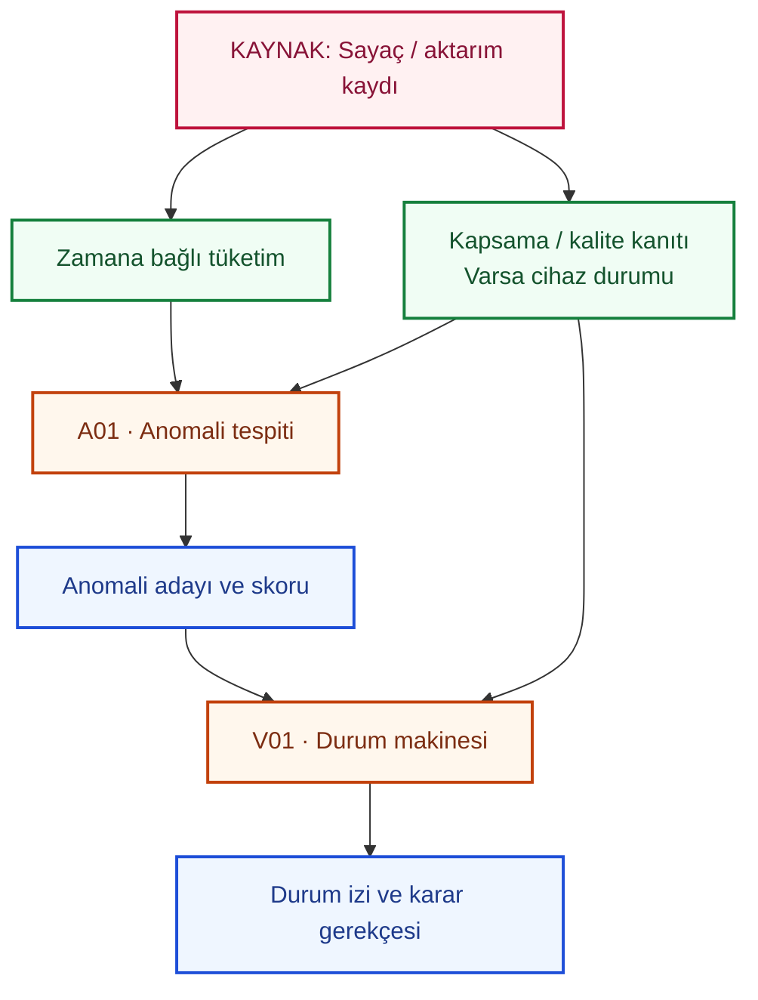
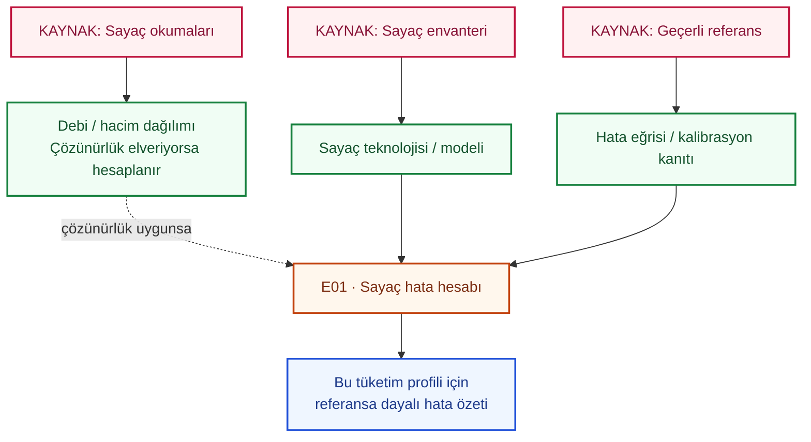

# İlk model eğitim planı

Durum: **planlama taslağı — eğitimler henüz çalıştırılmadı**.
Son güncelleme: 27 Ekim 2026.

Bu belge [model akış haritasının](research-data-model.md) eğitim karşılığıdır.
Veri alanları [JSON sözleşmesinde](research-data-contract.v0.1.schema.json), bilimsel
karşılaştırmalar ve değerlendirme kuralları
[araştırma protokollerinde](../../research/experiments/protocols.toml) tanımlanır.
Bu plan yeni bir veri alım formatı veya uygulanmış model API'si değildir.

[MF01–MF10 denetimi](model-flow-audit.md) bu planın kontrollerini ve henüz
kanıtlanmamış kısımlarını kaydeder. Koşullu hava kontrolleri yalnız ilgili
varyantlarda gerekir; geçmiş modeli hava kaynağına zorunlu bağımlı değildir.
`base_gates`, `optional_gates` ve `variants` JSON planında ayrı tutulur.

## Kullanıcının kesinleştirdiği deney kararları

27 Ekim 2026 tarihinde aşağıdaki üç seçim yapıldı; bunlar JSON plandaki
`experiment_design` alanlarına ve araştırma protokollerine işlendi.

| Akış | Karar | Deneyde uygulanacak ayrım |
|---|---|---|
| F01 | 18:00 ve 23:00, Europe/Istanbul | Aynı ertesi takvim günü için ayrı fit, koşum ve başarı raporu. Aynı hane/hedef gün her iki saatte ve bütün varyantlarda aynı bölmede tutulur. |
| P01 | İki profil yaklaşımı | Tüketimle kümeleyip anketle yorumlama ile tüketim+hane bağlamıyla kümeleme ayrı deneylerdir. Ortak haneler/dönemler ve ortak tüketim uzayı üzerinden karşılaştırılır. |
| A01/V01 | Üç ayrı senaryo ailesi | Kaçak; misafir/boş kalma gibi normal değişimler; cihaz/aktarım sorunları ayrı etiket ve raporlara sahiptir. Son iki grup kaçak etiketi değildir. |

18:00–23:00 karşılaştırması için F01'e **tahmin saatine kadar gözlenen gün içi
tüketim** özelliği eklendi (`intraday_history`). Yerel gün başlangıcından ilgili
`as_of` öncesine kadar erişilmiş okuma/revisionlarla litre, geçen süre ve kapsama
çıkarılır. 23:00 özelliği 18:00 koşumunda kullanılmaz; eksik saatler sıfır yapılmaz,
gün içi kısmi toplam tam günlük tüketim sayılmaz. Bu özellik tanımıdır; özellik
üretim kodunun çalıştığı iddiası değildir.

Saatler kendi bütün uygun örneklemlerinde raporlanır; saatler arası karşılaştırma
ayrıca **ortak uygun hane/hedef günler** üzerinde eşlenmiş yapılır. Eşlenemeyen
örnekler ve gerekçeleri ayrı gösterilir. Mevsimsel naif, yalnız geçmiş, hane ve hava
varyantları aynı zaman/örneklem ayrımını korur. İki saat tek raporda karıştırılmaz.

Profillerin farklı özellik uzaylarındaki silhouette değerleri doğrudan
birbirinden üstünlük kanıtı sayılmaz. Ortak tüketim uzayındaki karşılaştırma ve
kararlılık raporlanır; yerel/dağıtık sonuç eşdeğerliği her yaklaşımın kendi içinde
kontrol edilir. Hane bilgisi açıklama amaçlı kullanılan ilk yaklaşımın küme
öğrenmesine sonradan eklenmez.

Normal davranış değişimi genel bir olağandışı tüketim adayı oluşturabilir; bu,
kaçak olduğu anlamına gelmez. Kaçak başarısı bağımsız kaçak etiketleriyle, normal
değişimlerdeki yanlış kaçak alarmı ayrıca değerlendirilir. Cihaz/veri sorunları
kalite/yeterlilik tarafına ayrılır. Gizli arıza veya senaryo gerçeği modele
özellik olarak aktarılmaz; yalnız gerçekten gözlenebilir durum kanıtı kullanılır.

## İlk yöntem adayları ve düzenlenebilir akışlar

Kaynak–alan–model eşleştirmesi [JSON model planında](model-flow-map.v0.1.json)
tutulur. [Seçilebilir renkli görünüm](model-flow-map.html) ve
[model başına ayrıntılı diyagramlar](model-flow-map.md) bu kaynaktan üretilir.
Tam hedef, girdi rolleri, ilk parametreler, gereksinimler ve açık kararlar her
modelin kartındadır. İlk öğrenilmiş yöntem adayları artık belirlenmiştir:

- **P01:** [KMeans](https://scikit-learn.org/stable/modules/generated/sklearn.cluster.KMeans.html).
  İlk karşılaştırma yalnız tüketim şeklidir; aday bağlamın kümeye katılması ile
  yalnız yorumda kullanılması ayrıdır. Küme sayısı doğrulama ve kararlılıkla seçilir.
- **F01/F02:** [HistGradientBoostingRegressor](https://scikit-learn.org/stable/modules/generated/sklearn.ensemble.HistGradientBoostingRegressor.html).
  Mevsimsel naif, yalnız geçmiş ve bağlamlı varyantlar karşılaştırılır. İlk aday
  Poisson kaybıdır; negatif olmayan ve toplamı pozitif eğitim hedefi gerekir.
  İçeride rastgele validasyon oluşturmamak için `early_stopping=False` planlanır.
  F02, aynı tahmin anındaki bilgiyle 24 ayrı doğrudan ufuk modeli olarak başlar.
- **A01:** [IsolationForest](https://scikit-learn.org/stable/modules/generated/sklearn.ensemble.IsolationForest.html).
  Eşik tabanlı karşılaştırma korunur; karar eşiği test verisine bakılarak seçilmez.
- **V01:** öğrenilmiş model yerine sürümlü durum/geçiş kuralları ve biçimsel kontroller.
- **E01:** uygun debi ve referans eğrisi üzerinde hacim ağırlıklı hata hesabı.
  Ağırlıklar referans hacimlerdir; ölçülen hacimlerden dönüşüm gerekiyorsa hata
  tanımı ve debi temeli doğrulanır. Yüzde hata oran hesabında 100'e bölünür.
- **F03:** bağımsız bölge verisine bağlı ayrı uzantı; hedef dönem/çözünürlük ve
  algoritması bu veri doğrulanınca seçilir.

Bunlar ilk deneme seçimlerimizdir; veri üzerinde doğrulanmış üstünlük iddiası
taşımaz. Parametreler JSON kartlarındadır. Zaman bölmeleri takvim anlarına göre
kurulmalıdır; çok haneli veride düz satır sırasına `TimeSeriesSplit` uygulamak
tek başına grup ve hedef ufku ayrımını sağlamaz. Zaman serisi bölmesinin temel
yaklaşımı [resmi belgede](https://scikit-learn.org/stable/modules/generated/sklearn.model_selection.TimeSeriesSplit.html)
yer alır; hane holdout ve hedef blok kontrolleri ayrıca uygulanacaktır.

## Renk ve ok sözlüğü

- **Kırmızı:** kaynak; veri hangi cihaz, kurum veya formdan geliyor?
- **Yeşil:** veri / özellik; modelin kullanacağı somut alan nedir?
- **Turuncu:** model veya analiz; hangi işlem yapılacak?
- **Mavi:** çıktı; hangi soru cevaplanacak, hangi sonuç kaydedilecek?
- **Düz ok:** planlanan temel veri akışı. Tamamlandığı anlamına gelmez.
- **Kesikli ok:** deneyle kararlaştırılacak veya ek veri koşuluna bağlı bağlantı.

Her alanın rolü ayrıca yazılır: girdi özelliği, tahmin hedefi, değerlendirme etiketi,
kimlik/eşleştirme anahtarı veya kalite bilgisi. Aynı kayıt her rolü birden taşımaz.

## İlk deneylerin tanımı

Kimlikler diyagramlarda ve ileride deney çıktılarında aynı tutulacaktır. Günlük ve
saatlik tahmin tek model başlığı altında görünse de iki ayrı deneydir.

| Kimlik | Model / adım | İlk girdi ve hedef | İlk karşılaştırma ve değerlendirme |
|---|---|---|---|
| P01 | Tüketim profili / kümeleme | Temel girdi: kapsaması denetlenmiş saatlik/günlük tüketim şekli. Çıktı: hane/dönem için küme ataması ve profil özeti. Hazır bir doğru küme etiketi varsayılmaz. | Önce yalnız tüketim; sonra hane bağlamının özellik olması ile yalnız profil yorumunda kullanılması ayrı deneyler. Ön işleme yalnız eğitim döneminde öğrenilir; küme kararlılığı incelenir. Dağıtık çalıştırma eklenirse yerel sonuçla eşdeğerlik ve kaynak kullanımı ayrıca ölçülür. |
| F01 | Ertesi takvim günü toplam tüketim tahmini | Girdi: tahmin anına kadar tüketim geçmişi. Hedef: sonraki yerel takvim günündeki litre toplamı. H01 ve diğer hane/hava alanları ayrı bağlam deneyinde eklenir. | Mevsimsel naif → yalnız geçmiş kullanan model → bağlamlı model. İleri kayan zaman bölmeleri ve ayrı hane dışarıda bırakma deneyi. MAE, RMSE, sıfır paydalı durumları açıklanan WAPE; aralık üretiliyorsa kapsama. |
| F02 | Sonraki 24 saatlik tüketim tahmini | Girdi: yeterli çözünürlükte geçmiş tüketim. Hedef: tahmin anından sonraki 24 saatlik değerler. Tahmin anında bilinen hava ve hane bağlamı ayrı deneyde eklenir. | F01 ile aynı karşılaştırma aileleri; saatlik ayrı başarı raporu. Günlük/saatlik toplamlar yalnız dönemleri örtüşürse karşılaştırılır. |
| A01 | Anomali tespiti | Girdi: zaman çözünürlüklü tüketim ve kapsama/kalite kanıtı; varsa cihaz durumu. Çıktı: aday zaman aralığı ve yöntem/yönü belirtilmiş skor. Katılımcı kaçak bildirimi kesin eğitim etiketi değildir. | Eşik tabanı → IsolationForest adayı → dedektör + V01. Bağımsız olay referansı varsa olay yakalama, hane-gün başına yanlış alarm ve gecikme; referans yoksa bu ölçüler doğrulanmış gibi raporlanmaz. |
| V01 | Durum makinesi değerlendirmesi | Girdi: A01 adayları, açık veri-sembol eşlemesi ve gözlem/durum kanıtı. Çıktı: durum izi, geçiş ve karar gerekçesi. | Eğitim gerektirmeyen kural/biçimsel model olabilir. Geçersiz geçişler, kilitlenme, anlamsız doğrulama ve uygulama-model uyumu kontrol edilir. Karar sahada doğrulanmış kaçak etiketi değildir. |
| E01 | Sayaç hata / performans hesabı | Girdi: uygun çözünürlükte debi/hacim profili, sayaç teknoloji/modeli ve geçerli hata eğrisi veya kalibrasyon kanıtı. Çıktı: referans ve varsayımlar altında hata özeti. | Öğrenilmiş model gerektirmeyen analiz olabilir. Referans yoksa `insufficient_data`; hacim çözünürlüğü doğruluk yerine kullanılmaz. Gerçek hata doğrulaması için bağımsız referans gerekir. |

## Destekleyici iki akış

Ana haritayı kalabalıklaştırmamak için V01 ve E01 burada ayrıca açılır.

V01'e giden gözlemler tanımlı veri-sembol dönüşümünden geçirilir; durum makinesinin
durumları ve geçişleri çalıştırma öncesinde ayrıca tanımlanmalıdır.

## Her ilk eğitimden önce doldurulacak deney kartı

1. **Soru ve kapsam:** model kimliği, hedef hane/ölçüm noktası/bölge, zaman
   çözünürlüğü, hedef dönem ve tahminin yapıldığı an.
2. **Veri:** sürümlü dataset kimliği, kaynak/sözleşme sürümleri, kullanılan alanlar
   ve rolleri, dönem/örneklem kapsamı, dışlanan kayıtlar ve gerekçeleri.
3. **Bölmeler:** eğitim/doğrulama/test dönemleri, gerekiyorsa ayrılan haneler.
   Geçmiş pencere ve ileri hedef aralıklarının bölme sınırlarında bilgi sızdırmadığı
   doğrulanır; rastgele satır bölmesi varsayılan yöntem değildir.
4. **Hazırlık:** eksiklik ve kapsama koşulları, zaman kovaları, gecikmeler, varsa
   normalizasyon/doldurma. Bu işlemlerin öğrenilen ayarları yalnız eğitim verisinden çıkarılır.
5. **Yöntem:** JSON kartındaki ilk algoritma adayı, basit karşılaştırma, parametreler,
   rastgelelik tohumu, kod ve bağımlılık sürümü. Doğrulama sonrası yöntem değişirse
   gerekçesi kaydedilir; kütüphane sürümü eğitim ortamı hazırlanırken kilitlenir.
6. **Başarı:** kullanılacak ölçüler, dışlamalar, referans etiketi/gerçekliği ve
   varsa belirsizlik raporu. Sentetik başarı gerçek saha başarısı yerine geçmez.
7. **Çıktı:** model/işlem sürümü, veri bölmesi manifesti, tahmin/küme/aday kayıtları,
   ölçüm raporu ve varsa model dosyasının referansı/hash'i. Öğrenilmiş model olmayan
   V01/E01 için kural veya referans sürümü kaydedilir.

Tüketim hacmi bir sayaç/ölçüm noktası içindir; hane ataması tarihli kurulum ve
kapsamla çözülür. Ortak sayaç toplamı kişilere/hanelere kendiliğinden bölünmez.
Gerçek kimlik kodları eşleştirme içindir; varsayılan girdi özelliği değildir.

## İlk eğitimlere geçiş koşulları ve açık kararlar

- Mevcut küçük sentetik örnek altyapı doğruluğunu gösterir; hane davranışı öğrenmek
  için yeterli ve gerçekçi eğitim verisi olduğu varsayılmaz. Önce deney amacına
  uygun sentetik kapsam ve ayrı değerlendirme gerçeği hazırlanmalıdır.
- İlk algoritma adayları seçildi. Veri pencereleri, kapsama eşikleri ve uygun hane
  sayısı henüz kesin değildir; veri profili ve deney amacı üzerinden kartlara yazılır.
- Bölgesel tahmin ve kuraklık deneyleri için bağımsız bölge verisi, temsil ve
  senaryo varsayımları ayrıca tanımlanır; pilot hane toplamıyla geçiş yapılmaz.
- İlk denemeler Python/notebook üzerinden ortak çekirdeği kullanacaktır. Bu belge
  hazırlanırken eğitim, yeni simülatör veya veritabanı değişikliği uygulanmamıştır.

## Değişiklik geçmişi

| Tarih | Revizyon | Değişiklik |
|---|---|---|
| 2026-10-27 | 1 | P01/F01/F02/A01/V01/E01 akışları, renk sözlüğü ve ilk deney kartı tanımlandı. |
| 2026-10-27 | 2 | İlk yöntem adayları, JSON planı, yeniden üretilebilir görünüm ve F03 koşullu uzantısı eklendi. Eğitimler henüz çalıştırılmadı. |
| 2026-10-27 | 3 | Eğitim/değerlendirme rolleri, koşullu varyantlar, erişim zamanı ve referans hacim temeli MF01–MF10 denetimiyle netleştirildi. |
| 2026-10-27 | 4 | Kullanıcı iki günlük tahmin saatini, iki profil yaklaşımını ve üç senaryo ailesini seçti. Eşlenmiş raporlama ve gün içi özellik tanımı eklendi. |
