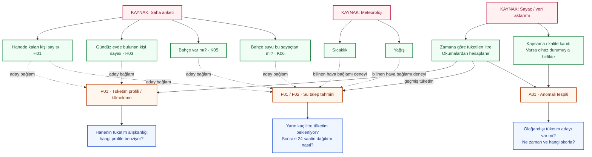
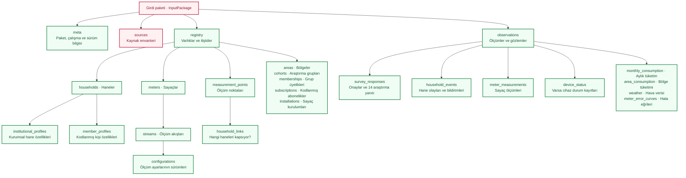
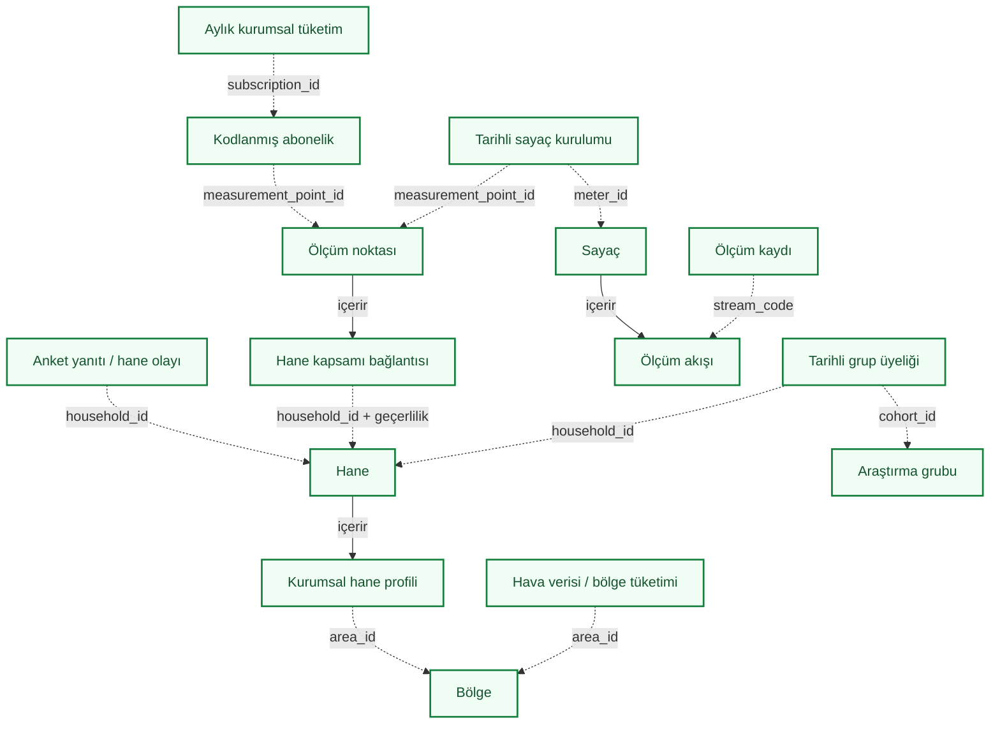
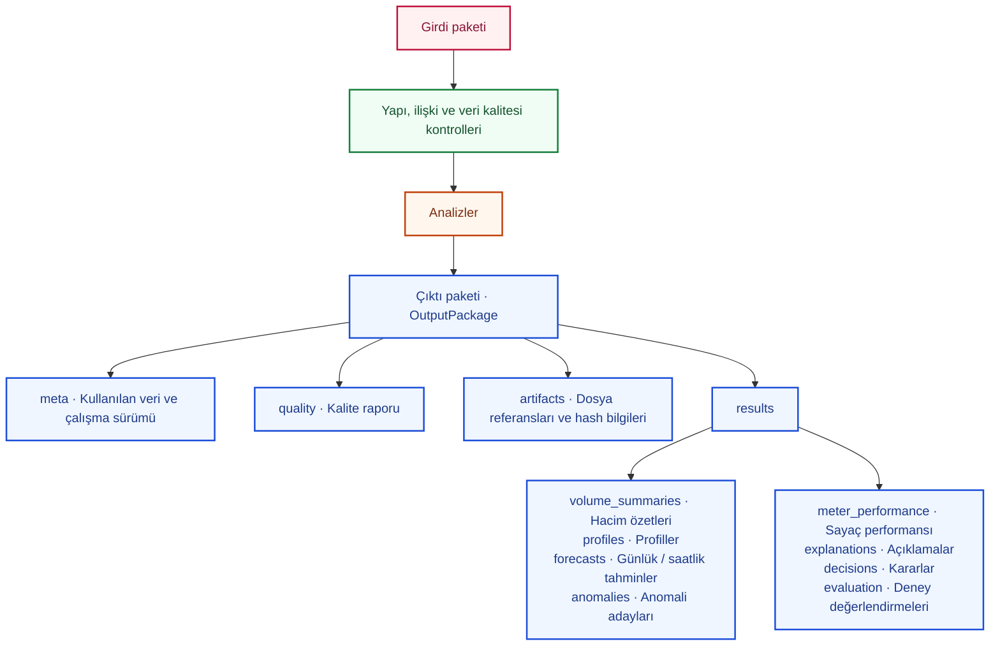

# Araştırma veri ve model akışı — kaynaklardan sonuçlara

Durum: **v0.1 sözleşmesine bağlı taslak — diyagram revizyonu 8 / deney kararları kaydedildi**.
Son güncelleme: 27 Ekim 2026.

Bu belge, konuşmada kararlaştırılan veri yerleşimini ve diyagramları kalıcı olarak
tutar. Alanların, tiplerin ve izin verilen değerlerin ayrıntılı karşılığı
[araştırma veri sözleşmesidir](research-data-contract.v0.1.schema.json).
Diyagramlar bu sözleşmenin okunabilir görünümüdür; ayrı bir alan tanımı kaynağı değildir.

Bu taslağın mevcut CLI veya veritabanında uygulanmış olduğu anlamı çıkarılmamalıdır.
Çalışan ilk paketin sözleşmesi hâlâ `synthetic.measurement.v1` biçimindedir;
[mevcut veri sözlüğü](../data-dictionary.md) ve [uygulama mimarisi](../architecture.md)
o paketi anlatır. Aşağıdaki analiz ve çıktı akışı hedef tasarımdır.

Bu belge model planlamasının ana haritasıdır. İlk eğitimlerin hedefleri, girdi
rolleri ve değerlendirme koşulları [ilk model eğitim planında](model-training-plan.md)
tutulur. Model kimlikleri iki belgede aynıdır; kesin algoritma seçimi ve eğitim
tamamlanması ayrıca kaydedilir.

## Projenin ayrıntılı model haritası

[Denetim bulguları, düzeltmeler ve kanıt sınırları](model-flow-audit.md) bu planın
parçasıdır. Denetlenmiş olması modellerin eğitildiği veya gerçek verinin
doğrulandığı anlamına gelmez.

**Tek parça toplu grafik:** [PNG](model-flow-overview.png),
[yakınlaştırılabilir SVG](model-flow-overview.svg), [A3 PDF](model-flow-overview.pdf).
51 alan ve 7 model/analiz aynı grafikte yer alır. Alanlar arası türetmeler de çizilir;
yorum/değerlendirme bağlantıları modelin eğitim girişine değil sonuç kutusuna gider.
A01'in çıktısı V01'in girdisidir; sekizinci mantıksal kaynak olan bu ara çıktı
ayrı bir cihaz/kurum gibi tekrarlanmaz. F03 koşullu bölgesel uzantıdır.

[Model seçerek inceleme görünümü](model-flow-map.html), gerçek alan adlarıyla
8 kaynağı ve P01/F01/F02/A01/V01/E01/F03 akışlarını açar. Yeşil alan seçilince
ilgili modeller ve alanın rolü görünür. Yorum/değerlendirme kayıtları eğitim
oklarından ayrı tutulur; bağımsız bölge verisine bağlı F03 ayrıca işaretlidir.

Bağlantıların düzenlenebilir kaynağı [model akış planı JSON'udur](model-flow-map.v0.1.json).
[Tüm model diyagramları ve ilk yöntem adayları](model-flow-map.md) bu kaynaktan
üretilir. Aşağıdaki kısa ana görünüm bir özettir; ayrıntılı model bağlantılarını
değiştirirken JSON planı güncellenir. Veri alanlarının tipleri için JSON Schema
otoritedir; plan onu değiştirmez.

```powershell
.\.venv\Scripts\python.exe scripts/build_model_flow_map.py
.\.venv\Scripts\python.exe scripts/build_model_flow_map.py --check
```

Toplu SVG de aynı komutla güncellenir. PNG ve PDF'yi yeniden üretmek için isteğe
bağlı dışa aktarma komutu `node scripts/export_model_flow_graph.cjs` şeklindedir;
Playwright ve kurulu Chrome gerekir. Bu ikisi uygulama çekirdeğinin bağımlılığı
değildir. SVG yalnız Python standart kütüphanesiyle üretilir. Dışa aktarma sırasında
51 alan, 7 model ve 85 alan–model bağlantısı kontrol edilir; etiket taşmaları ve
çakışan kutular denetlenir. Kontrol manifesti
[dışa aktarma kaydında](model-flow-overview.exports.json) tutulur. JSON planı değişirse
`--check` eski PNG/PDF çıktısını SVG ve çıktı dosyalarının ayrı SHA256 özetleriyle
bildirir. Eksik manifest de hatadır; sözleşme kimliği üretilen görünümlere bağlanır.

Bu komutlar görüntüleri yeniden üretir ve eşleşmelerini denetler; veri alımı veya
model eğitimi başlatmaz. İlk öğrenilmiş yöntem adayları ve ayrı değerlendirme
koşulları eğitim planında kayıtlıdır. Algoritma seçimi, başarılı eğitim anlamına gelmez.

## 0. Ana görünüm: hangi kaynaktaki hangi veri, hangi modele gidiyor?

Bu görünüm, kullanıcının paylaştığı elle çizilmiş kaynak–alan–model–sonuç örneğine
göre düzenlenmiştir. Her kaynak kendi veri alanlarına açılır; alanlardan ilgili
modele doğrudan ok gider ve modelin altında cevapladığı soru bulunur. Ortak bir
"gelen veriler" veya "hazırlık" kutusu bu bağlantıları gizlemez.

İlk diyagram, okunabilir olması için seçilmiş gerçek alanlarla ana araştırma
akışını gösterir. Tüm anket sorularını veya bütün kaynakları içermez; diğer
kaynaklar ve destekleyici alanlar aşağıdaki eşleştirme tablosunda, tam JSON
yerleşimi bölüm 1'de bulunur. Örnekteki saç durumu gibi toplamadığımız alanlar
eklenmez; gelir verimiz de kesin maaş değil, kaynakta tanımlanan gelir bandıdır.

Oklar **planlanan kullanım bağlantılarıdır**; seçilmiş algoritma, doğrulanmış etki
veya çalışan model anlamına gelmez. Hane bağlamının özellik olarak eklenmesi ayrı
deneyle sınanır. Kaynak kutusu verinin teslim alındığı anlamına gelmez.

**Renkler:** kırmızı = kaynak, yeşil = veri / özellik, turuncu = model / analiz,
mavi = çıktı. Düz ok temel veri akışını, kesikli ok denenmesi gereken aday veya
koşullu bağlantıyı gösterir. Bu ok açıklaması ana model diyagramına aittir;
bölüm 2'deki kayıt ilişki diyagramının kendi açıklaması vardır.



### Ana görünümde gösterilmeyen alan ve bağlantılar

Bu tablo çizimin devamıdır. Bir alanın mevcut olması onu otomatik olarak modele
zorunlu girdi yapmaz. Özellikle katılımcı bildirimi, ölçüm kapsamı ve değerlendirme
etiketi ayrı roller taşır.

| Kaynak | Veri alanı | Bağlandığı model / adım | Rolü ve sonuç |
|---|---|---|---|
| Anket | H04: yıl boyu / dönemsel kullanım | Bağlamlı tahmin ve profil deneyi | Kullanım düzenini temsil eden aday bağlam. |
| Anket | G01: gelir bandı | Bağlamlı tahmin / profil incelemesi | Kaynak sözlüğü korunur; kesin maaş veya nedensel etki değildir. |
| Anket | K01: konut türü, K03: alan bandı | Bağlamlı tahmin / profil deneyi | Konut bağlamı için ayrı aday özellikler. |
| Anket | E01: cihazların bulunması | Bağlamlı tahmin / profil deneyi | Cihaz varlığıdır; çalışma sıklığı veya ayrı cihaz tüketimi verisi değildir. |
| Anket | K09: alternatif su kaynağı, K10: depo | Tahmin bağlamı ve tüketimin yorumlanması | Ölçülen suyun kapsamını etkileyebilecek bilgi. |
| Anket | K08: sayaç yalnız bu haneyi mi ölçüyor? | Hane kapsamı kontrolü | Hedefin hangi haneye ait olduğunu değerlendirmeye yardım eder; teknik doğrulamanın yerine geçmez. |
| Anket / saha | D07: kaçak bildirimi, O01: olağandışı dönem / olay | Olay incelemesi ve değerlendirme | Kesin olay etiketi değildir; geçmiş tahminlere sonradan öğrenilen bilgi olarak sızdırılmaz. |
| İSU hane / kişi tabloları | Hane nüfusu, konut, evcil hayvan, eski gelir sınıfı; kişi yaş/eğitim/faaliyet vb. kategorileri | Profil incelemesi, uygun bağlamlı deneyler | Haneye bağlı kayıtlar; eski/yeni gelir sözlükleri birleştirilmez, kişisel tüketim ölçüldüğü varsayılmaz. |
| İSU registry kayıtları | Abonelik, sayaç, kurulum, ölçüm noktası, bölge, geçerlilik | Kaynakları eşleştirme | Ölçümün doğru hedefe ve döneme bağlanması; kimlik kodları varsayılan öğrenme özelliği değildir. |
| Sayaç sağlayıcısı, varsa | Cihaz durumu ve kapsama kanıtı | Anomali tespiti / durum makinesi | Ölçüm yokluğunun tüketim sıfırıyla karıştırılmasını önlemeye yardım eder. |
| İSU tüketim kayıtları | Aylık tüketim | Dönem karşılaştırması ve uygun tarihli tahmin deneyi | Saatlik ölçüme eklenerek çift sayılmaz; geç gelen ay toplamı geçmiş tahmine girdi olamaz. |
| İSU tüketim kayıtları | Bağımsız bölgesel toplam | Bölgesel tahmin / doğrulama | Temsil ve kapsama koşulları ayrıca sağlanır; hane tahminiyle ayrı deneydir. |
| Meteoroloji, varsa | Kuraklık indeksi | Bölgesel / senaryo tahmin deneyi | Varsayımsal senaryo, ölçülmüş nedensel tepki değildir. |
| Sayaç referans kaynağı + ölçümler | Hata eğrisi, sayaç teknoloji/modeli, uygun çözünürlükte debi/hacim profili | Sayaç hata / performans hesabı | Referans ve varsayımlar altında hata özeti; bağımsız ölçülmüş gerçek hata iddiası değildir. |
| Anomali modelinin çıktısı + tanımlı gözlem sembolleri | Anomali adayları, olay zamanı, durum ve geçiş kanıtı | Durum makinesi | Gerekçeli karar / durum izi; tek başına doğrulanmış saha olayı değildir. |

### Hangi model hangi veriyi kullanacak?

Model aileleri araştırma hedeflerini anlatır; ilk algoritma/parametre adayları
JSON planında kayıtlıdır. Nihai seçim deney sonuçlarından sonra yapılır.
Deneylerin karşılaştırmaları ve kabul koşulları için
[araştırma protokolleri](../../research/experiments/protocols.toml) esas alınır.
Her deney kendi alan listesini, hedefini, zaman aralığını ve dışlama gerekçelerini
kaydeder. Aynı haneye ait farklı kaynaklar hane kodu ve geçerlilik zamanı üzerinden,
hava verisi ise bölge ve zaman üzerinden eşleştirilir. Alanı modele bağlayan ok,
gerekli kaynak ve kalite kontrollerinin atlandığı anlamına gelmez.

| Model / analiz | Kullanacağı veri | Sonuç | Çalıştırma / yorum koşulu |
|---|---|---|---|
| Davranış profili / kümeleme | Saatlik/günlük tüketim şekli ve kapsama; uygunsa tarihli hane/anket bağlamı | `profiles` | Küme numarası gerçek kişi etiketi değildir. Yerel ve dağıtık işleme aynı veri anlamını korumalıdır. |
| Günlük talep tahmini | Geçmiş tüketim, uygun gecikmeli özetler, tahmin anında bilinen hane ve çevre bağlamı | `forecasts` | Hedef sonraki yerel takvim gününün toplamıdır; mevsimsel naif ve yalnız geçmiş kullanan karşılaştırmalar bulunur. |
| Saatlik talep tahmini | Yeterli zaman çözünürlüğündeki geçmiş tüketim ve tahmin anında bilinen bağlam | `forecasts` | Hedef sonraki 24 saatlik değerlerdir; günlük deneyden ayrı veri bölmesi / başarı raporu tutulur. |
| Anomali tespiti | Tüketim dizisi, kapsama/kalite kanıtı, varsa cihaz durumu | `anomalies` | Eşik tabanlı karşılaştırma bulunur. Şüpheli tüketim doğrulanmış kaçak sayılmaz. |
| Durum makinesi değerlendirmesi | Anomali adayları, açık veri-sembol dönüşümü, durum ve geçiş kuralları | `decisions` | Öğrenilmiş model olmak zorunda değildir. Durum makinesi kararı tek başına sahada doğrulanmış olay etiketi değildir. |
| Sayaç hata / performans hesabı | Uygun çözünürlükte debi/hacim profili, sayaç modeli ve geçerli referans eğrisi / kalibrasyon kanıtı | `meter_performance` | Referans ve varsayımlar raporlanır. Referans eğrisiyle hesaplanan hata, bağımsız ölçülmüş gerçek hata diye sunulmaz. |

`volume_summaries` ölçümlerden hesaplanan gözlenen hacimlerin analiz çıktısıdır; öğrenilmiş
model gerektirmez. `explanations` ilgili sonuç kimliğine bağlanır. `evaluation`
ayrı değerlendirme adımında, uygun referanslar ve deney bölmeleriyle üretilir.
Sentetik gizli gerçekler / bağımsız uzman etiketleri bu adımda kullanılabilir;
girdi özelliklerine veya tahmin anında mevcut olmayan bilgiye dönüştürülmez.
Denetimli bir eğitimde etiket gerekirse yalnız ilgili eğitim bölmesine kontrollü
olarak verilir, doğrulama ve test etiketleri özellik hazırlığından ayrı tutulur.

### Katmanlar arasındaki sınırlar

- Tahminin eğitiminde kullanılan doldurma, ölçekleme ve özellik seçimi yalnız
  eğitim bölmesinde öğrenilir. Tahmin anından sonra yayımlanan hava veya hane bilgisi
  geçmiş tahminin girdisi olamaz. Gruplar arası bağlam veya profil özellikleri de
  doğrulama / test verisinden öğrenilmez.
- Hane ve bölge deneyleri ayrı kapsamdır. Bölge tahminini doğrulamak için bağımsız
  bölgesel toplam, kapsama ve temsil koşulları gerekir. Kuraklık senaryosu sonucunun
  gözlenmiş veya nedensel etki olduğu varsayılmaz.
- Durum makinesi doğrulaması; açık veri-sembol eşlemesi, uygulama ile model uyumu,
  kilitlenme ve anlamsız doğrulama kontrolleriyle ayrıca değerlendirilir.
- Dağıtık işleme bir tahmin modeli değildir; veri hazırlama ve profil çıkarma
  çalışmasının yürütme biçimidir. Yerel / dağıtık sonuç eşdeğerliği ve performans
  ayrı ölçülür; tek bilgisayardaki çalışma çok makinede ölçek kanıtı sayılmaz.
- Yetersiz girdiye sahip dal `insufficient_data`, istenmeyen dal `not_requested`
  sonucunu bildirir. Bir modelin çalışabilmesi için bütün kaynakların dolu olması
  gerekmez; her dalın asgari gereksinimi ayrı uygulanır.

## 1. Girdilerin JSON içindeki yeri

Oklar **içinde bulunmayı** gösterir. Çoğul varlık kutuları kayıt listeleridir.
`InputPackage` ve `OutputPackage` ayrı paket türleridir; tek veri nesnesinin içine
birlikte yerleştirilmezler.



### Kaynakların karşılığı

Bir veri grubunun sözleşmede bulunması, o verinin teslim alındığı veya eksiksiz
olduğu anlamına gelmez. Kaynak envanteri ve veri kalitesi raporu bu durumu ayrıca belirtir.

| Kaynak / veri grubu | Sözleşmedeki yer | Yorum |
|---|---|---|
| Mevcut kurumsal hane ve kişi tabloları | `registry.households[].institutional_profiles[]`, `member_profiles[]` | Hane bilgisi ve kişi bilgisi ayrılır; birden fazla kişi satırı ayrı hane sayılmaz. |
| Güncel kısa saha anketi | `observations.survey_responses[]` | 14 araştırma yanıtı, idari alanlar ve onay durumları; boş soru formu doldurulmuş yanıt değildir. |
| Sayaç, abonelik ve kurulum bilgisi | `registry.meters[]`, `subscriptions[]`, `installations[]`, `measurement_points[]` | Gerçek sağlayıcı alan eşlemesi örnek kayıtlarla doğrulanacaktır. |
| Sayaç okumaları | `observations.meter_measurements[]` | Ölçüm akışına bağlanır; hane veya kişi içine kopyalanmaz. |
| Hane olayları / bildirimleri | `observations.household_events[]` | Bildirim, doğrulanmış olay etiketiyle aynı şey değildir. |
| Cihaz bağlantı / durum kayıtları | `observations.device_status[]` | Sağlayıcı sunarsa kullanılır; ölçüm yokluğundan üretilmez. |
| Kurumsal aylık ve bölgesel tüketimler | `observations.monthly_consumption[]`, `area_consumption[]` | Erişim ve kapsam doğrulanacaktır; pilot hane toplamı bölge toplamı sayılmaz. |
| Hava gözlemleri / tahminleri | `observations.weather[]` | Bölge ve zaman bağlantısı, tahmin için yayımlanma zamanı korunur. |
| Sayaç referans hata eğrileri | `observations.meter_error_curves[]` | Uygun teknoloji/model için mevcut ve geçerliyse kullanılır. |

## 2. Kayıtların birbirine bağlanması

Kesikli oklar **kimlik referansını**, düz ok **JSON içinde bulunmayı** gösterir.
Kurulum, abonelik, hane kapsamı ve grup üyeliği ilişkileri geçerlilik dönemiyle
yorumlanır. Hane, abonelik, ölçüm noktası ve sayaç aynı varlık değildir.



Kaynak taşıyan kayıtlardaki `source_ref.source_id`, paket içindeki `sources`
envanterine veya daha önce kaydedilmiş kaynak envanterine bağlanır. Diyagramın
okunabilmesi için her kutudan kaynak envanterine ayrı ok çizilmemiştir.

### Bağlantıların koruması gereken kurallar

- Ölçümün haneye atanması, ölçüm zamanındaki kurulum ve ölçüm noktası kapsamından
  çözülür. Ortak veya kapsamı bilinmeyen sayaç toplamı tek hane tüketimi sayılmaz;
  hanelere eşit bölünmez.
- Gerçek abone numarası, ad, telefon ve açık adres araştırma paketine girmez.
  Gerçek kimlikle araştırma kodu arasındaki eşleme sağlayıcıda kalır.
- Aylık tüketim ile pulse/endeks/dönem hacmi aynı suyun farklı temsilleri olabilir;
  birlikte toplanmaz.
- Eksik ölçüm sıfır tüketim veya cihaz kesintisi olarak yorumlanmaz. Yanıtlarda
  sıfır, bilinmeyen, yanıtlanmamış ve uygulanamaz ayrı tutulur.
- Eski gelir ve konut sınıfları kaynak sözlüğüyle korunur; yeni anket kategorilerine
  kanıtsız dönüşüm yapılmaz. `8+` kişi tam sekiz kişi kabul edilmez.
- Profil, kurulum ve kaynak zamanları korunur. Sonradan öğrenilen bilgi geçmiş
  tahmin deneylerine sızdırılmaz. Dönemler başlangıç dahil, bitiş hariçtir.
- JSON Schema yapısal doğrulama sağlar. Kimlik tekilliği, referansların çözülmesi,
  zaman sırası ve geçerlilik çakışmaları ayrıca semantik kontrol gerektirir.
- Sentetik üretimin gizli gerçek olayları ve etiketleri girdi paketine eklenmez;
  değerlendirme tarafında ayrı tutulur.

## 3. Hedef işleme ve çıktı akışı



Her sonuç ailesi `status`, `reason_codes` ve `records` taşır. Analizin
istenmemesi (`not_requested`), yeterli veri bulunmaması (`insufficient_data`) ve
sonuç üretilmesi (`ready` / `partial`) ayrıdır. Üretilemeyen sayısal değer sıfırla
doldurulmaz. Boş anomali listesi ancak durumuyla birlikte yorumlanır.

Günlük tahmin sonraki yerel takvim gününü, saatlik tahmin sonraki 24 saatlik aralığı
hedefler; ayrı deney ve başarı raporları vardır. Açıklamalar ilgili sonuç kaydına
bağlanır, tek başına nedensel kanıt sayılmaz. Referans hata eğrisi olmadan ölçülmüş
sayaç doğruluğu iddiası kurulmaz.

Çıktı metadata'sındaki girdi paketi kimlikleri ve dataset kimliği kaynak zincirini
korur. Bu mantıksal yapı, bütün okumaların tek büyük JSON dosyasına konulmasını
gerektirmez; büyük veriler paketler ve dosya referanslarıyla taşınabilir.

## Revizyon yöntemi

1. Alan, tip, zorunluluk veya ilişki değişince önce JSON sözleşmesini güncelleyin.
2. Aynı değişiklikte bu belgedeki diyagramları, kaynak karşılıklarını ve kuralları
   sözleşmeyle eşitleyin. Mermaid kod blokları diyagramların düzenlenebilir kaynağıdır.
3. JSON Schema geçerliliğini kontrol edin; kayıtlar arası kurallar için gereken
   semantik kontrolleri ayrıca belirtin. Uygulama değiştiyse ilgili testleri çalıştırın.
4. Uygulamaya geçişi ayrıca kaydedin; tasarım belgesinin güncellenmesini çalışan
   veri alım desteği gibi göstermeyin. Yayımlanmış bir sözleşmede uyumsuz değişiklik
   yapılıyorsa yeni sürüm oluşturup geçişi açıklayın.
5. Aşağıdaki geçmişe tarih ve değişiklik gerekçesi ekleyin. Git geçmişi değişikliklerin
   ayrıntılı kaydıdır; bu dosyaların geçmişe girmesi için ayrıca commit gerekir.

## Değişiklik geçmişi

| Tarih | Sürüm | Değişiklik |
|---|---|---|
| 2026-10-27 | v0.1 taslak | Görüşmedeki girdi yerleşimi, kayıt ilişkileri ve hedef çıktı akışı kaydedildi; kaynak karşılıkları ve revizyon yöntemi eklendi. |
| 2026-10-27 | Diyagram revizyonu 2 | Kaynak → veri → ilişki/hazırlık → model/analiz → çıktı ana görünümü ve model-girdi-çıktı eşleştirmesi eklendi. JSON alanları ve sözleşme sürümü değiştirilmedi. |
| 2026-10-27 | Diyagram revizyonu 3 | Kullanıcının çizimine göre ana görünüm kaynak → tekil veri alanı → ilgili model → anlaşılır sonuç biçimine çevrildi. Alan–model bağlantılarını gizleyen ortak kutular kaldırıldı; diğer alanlar ve bağlantılar tabloya taşındı. JSON sözleşmesi değiştirilmedi. |
| 2026-10-27 | Diyagram revizyonu 4 | Kaynak/veri/model/çıktı renkleri, aday bağlantılar için kesikli oklar, kararlı model kimlikleri ve ilk eğitim planı eklendi. Eğitim çalıştırılmadı. |
| 2026-10-27 | Diyagram revizyonu 5 | Tüm model akışları tek JSON planında toplandı; seçilebilir renkli görünüm, model başına üretilen diyagramlar ve somut ilk algoritma adayları eklendi. |
| 2026-10-27 | Diyagram revizyonu 6 | Bütün alan, türetme, model ve sonuçlar tek parça SVG/PNG/A3 PDF olarak birleştirildi. Çıktı bütünlüğü ve yerleşim kontrolleri eklendi. |
| 2026-10-27 | Diyagram revizyonu 7 | MF01–MF10 denetimi: sızıntı/rol/provenans/döngü kontrolleri, koşullu varyantlar, skor ve bölgesel çıktı alanları, sayaç hata temeli ve çıktı hash kontrolleri düzeltildi. |
| 2026-10-27 | Diyagram revizyonu 8 | İki tahmin saati, iki profil yaklaşımı ve üç senaryo ailesi kullanıcı kararıyla kaydedildi. Gün içi özellik eklendi; toplu görünüm 51 alan/85 bağlantıya güncellendi. |
