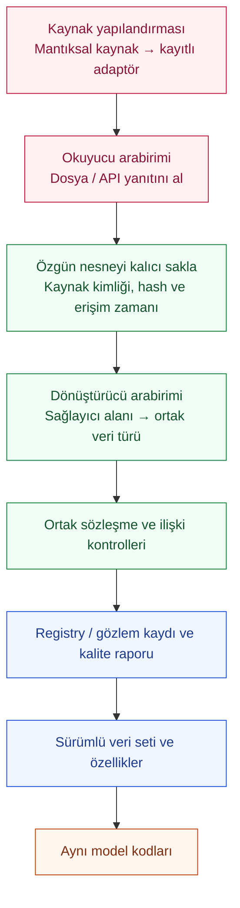

# Değiştirilebilir veri kaynakları ve adaptör arabirimleri

Tarih: 29 Ekim 2026. Durum: **ilk sayaç adaptörleri uygulandı; diğer kayıt aileleri tasarım**.

Amaç: Kaynak dosyası, sağlayıcı veya taşıma yolu değiştiğinde kaynak bağlantısı
ve gerekli adaptör değiştirilir; kalite, veri birleştirme, özellik üretimi ve model
kodları ortak araştırma sözleşmesi üzerinden çalışmayı sürdürür.

`uw collect` yapılandırmadan dosya/tek HTTP yanıtı ve JSONL/eşlemeli CSV seçer;
ortak ingestion ve worker yoluna bağlanır. Sentetik v1 geriye uyumludur;
ayrı açık araştırma ortamı `urban-water.measurement.v1` kullanır.
[Çalıştırma ve kapsam](source-adapters-usage.md) uygulanan kısmı gösterir.
[Araştırma girdi/çıktı şeması](contracts/research-data-contract.v0.1.schema.json)
henüz bütün kayıt aileleri için çalışan genel ingestion biçimi değildir.

## Ana akış



Kaynak adı ile okuma teknolojisi ayrıdır. Aynı CSV okuyucusu farklı alan
eşlemeleriyle iki kaynağa hizmet verebilir; aynı sayaç kaynağı önce JSONL,
sonra API ile gelebilir. Hazır ve uyumlu adaptörde yapılandırma değişir. Yeni
biçim/protokolde yeni reader veya normalizer gerekir; model kodu ortak türleri kullanır.

## Yapılandırma fikri

Aşağıdaki çok aileli örnek **ilerisi için tasarımdır**; hane/hava normalizer'ları
henüz uygulanmadı. Çalışan sayaç yapılandırması
[local-demo.toml](../configs/sources/local-demo.toml) dosyasındadır:

```toml
[sources.meter_readings]
reader = "local_file"
normalizer = "measurement_jsonl_v1"
path_env = "UW_METER_INPUT"

[sources.household_profiles]
reader = "local_file"
normalizer = "institutional_household_export"
path_env = "UW_HOUSEHOLD_INPUT"

[sources.weather]
reader = "local_file"
normalizer = "weather_fixture"
path_env = "UW_WEATHER_INPUT"
```

## Arabirimler ve görevleri

| Bileşen | Görev | Döndürdüğü |
|---|---|---|
| `SourceReader` | Dosya, API sayfası veya başka kaynaktan özgün nesneyi almak | Nesne/dosya referansı, teslimat bilgisi ve varsa sonraki sayfa belirteci |
| `SourceNormalizer` | Saklanmış nesneyi sağlayıcı sözleşmesine göre çözmek | Türü belli ortak kayıtlar, özgün satır/olay referansları ve dönüştürme sorunları |
| `SourceRegistry` | Yapılandırmadaki adları uygulamada kayıtlı adaptörlerle eşlemek | Doğrulanmış bağlantı ve sabitlenmiş sürümler |
| Toplama yöneticisi | Tek seferlik veya sürekli toplama; kalıcı kabul ve ilerleme | Kaynak/job kimliği, tekrar bilgisi ve ilerleme/hata durumu |
| Ortak yayın/kalite katmanı | Tip, kimlik, ilişki ve zaman kontrolleri sonrası yayın | Registry/gözlem kayıtları ve ayrı kalite raporu |

Python'da arabirimler `typing.Protocol`, taşınan veriler açık modellerle
tanımlanabilir. `read() -> dict` / `list[Any]` gibi anlamı belirsiz tek veri torbası
yerine kayıt ailesi ve sürümü belli dönüşler kullanılır. Aynı üst arabirim altında
sayaç ve hava kayıtlarının alanları birbirine karıştırılmaz.

Okuyucu model çalıştırmaz; dönüştürücü DB'ye doğrudan yazmaz. Model kodunda dosya
açma, API çağırma veya sağlayıcı sütunu çözme mantığı bulunmaz.

## Bütün kaynakların karşılığı

| Mantıksal kaynak | Ortak araştırma karşılığı |
|---|---|
| Sayaç | `meter_measurements`; varsa ayrı `device_status` |
| Kısa anket | `survey_responses`; bağlantılı `household_events` |
| Kurumsal hane / kişi | `households` altında `institutional_profiles` ve `member_profiles` |
| Abonelik / kurulum | `subscriptions`, `measurement_points`, `installations`, `meters/streams/configurations` |
| Araştırma / bölge | `areas`, `cohorts`, `memberships` |
| Kurumsal tüketim | Ayrı dönem ve kapsamlarla `monthly_consumption`, `area_consumption` |
| Meteoroloji | `weather`; observed/forecast/scenario ve erişim/yayım zamanlarıyla |
| Sayaç referansı | `meter_error_curves`; debi ekseni ve hata tanımıyla |

Bir dosya birden fazla kayıt ailesi üretebilir. Kişi satırları ayrı hane, aylık
hacim ek tüketim sayılmaz. Büyük akışlar parçalı işlenir; bütün veri tek dev JSON'a
alınmaz. Sentetik kaynaklar aynı sözleşmeyi hedefler; gizli truth değerlendirmede kalır.

## Kaynak değişirken korunacak kurallar

- Özgün nesne parser çalışmadan kalıcı saklanır; hata olduğunda hash ve kaynak
  referansı korunur. Kurumsal kimlik eşleştirme anahtarı araştırma ortamına alınmaz.
- Reader, normalizer, alan eşlemesi ve sözleşme sürümleri teslimata pin'lenir.
  Gizli olmayan yapılandırma özeti kaydedilir; eski iş yeni ayarı sessizce kullanmaz.
- Dosya/teslimat tekilliği ile olay/revision tekilliği ayrıdır. Sağlayıcı namespace'i
  korunur; farklı sağlayıcıdaki aynı yerel olay kodu yanlışlıkla birleştirilmez.
- Kaynak cursor'ı ile parser satır checkpoint'i ayrıdır. Cursor ancak nesne kalıcı
  saklanıp source/job kabulü commit edildikten sonra ilerler. Worker kuyruktaki işi
  sürdürebilir; yayınlanmamış staging araştırma sorgularına görünmez.
- Olay, sağlayıcı alımı ve araştırmanın erişim zamanları ayrı tutulur. Bilinmeyen
  saat/birim/olay kimliği uydurulmaz; eksik ölçüm sıfır veya offline sayılmaz.
- Bilinmeyen sürüm, desteklenmeyen kayıt ailesi ve birim sorunu sessizce atlanmaz;
  ret/karantina politikasıyla görünür sonuç üretilir.
- Hane ataması tarihli registry ilişkileriyle yapılır; ortak sayaç hanelere otomatik
  bölünmez. Kaynak değişimi eski dataset'i değiştirmez; yeni sürüm üretilir.

## Mevcut koddan uygulamaya geçiş

1. Mevcut JSONL parser'ını reader/normalizer arabiriminin arkasına alın. Özgün
   dosya, kalite kodları, revision, checkpoint ve hacim sonuçlarını koruyun.
2. Kayıtlı adaptör seçimi ve kaynak yapılandırmasını ekleyin. Eski CLI geriye
   uyumlu kalsın; worker tanımadığı sürümü yanlış parser'la açmasın.
3. Diğer araştırma kayıt türlerinin uygulama modellerini, DB yayın yollarını ve
   semantik kontrollerini tamamlayın. Yalnız parser değiştirmek bunları sağlamaz.
4. Sentetik/dosya kaynaklarıyla aile bazında uçtan uca deneyin. Kaynak değişince
   aynı ortak kayıt/sonuç elde edildiğini; düzeltme ve yeni olayların kaybolmadığını sınayın.
5. Gerçek sağlayıcı örneğiyle reader/normalizer eşlemelerini kanıtlayın. Mevcut
   `UW_ENV=synthetic` sınırı ve kurum geçiş koşulları ayrıca ele alınır.

İlk regresyonlar: tekrar teslimat, farklı sağlayıcılarda aynı yerel olay kodu,
revision, bozuk satır, UTF-8, yeniden başlatma, cursor sonrası kapanış, bilinmeyen
sürüm, eksik cihaz kanıtı, hacim korunumu ve tarihli hane ataması. Gerçek API
bağlantısı ayrıca doğrulanır.

Bu geçiş [model akış planını](contracts/model-flow-map.v0.1.json) ve
[deney kararlarını](contracts/model-training-plan.md) kaynak teknolojisinden ayırır.

[Araştırma verisiyle başlangıç planı](research-data-bootstrap.md), ilk açık veri
adayını, sentetik üreticinin kalibrasyon sınırlarını ve dosyadan API'ye geçişin
somut kabul sırasını kaydeder.
